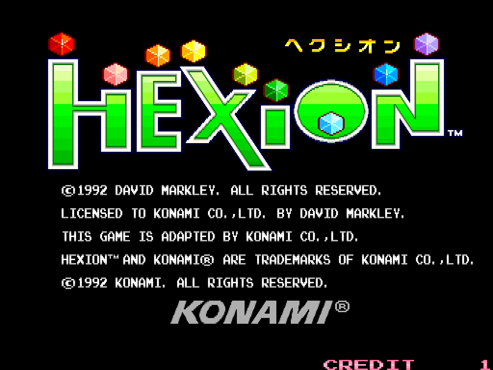
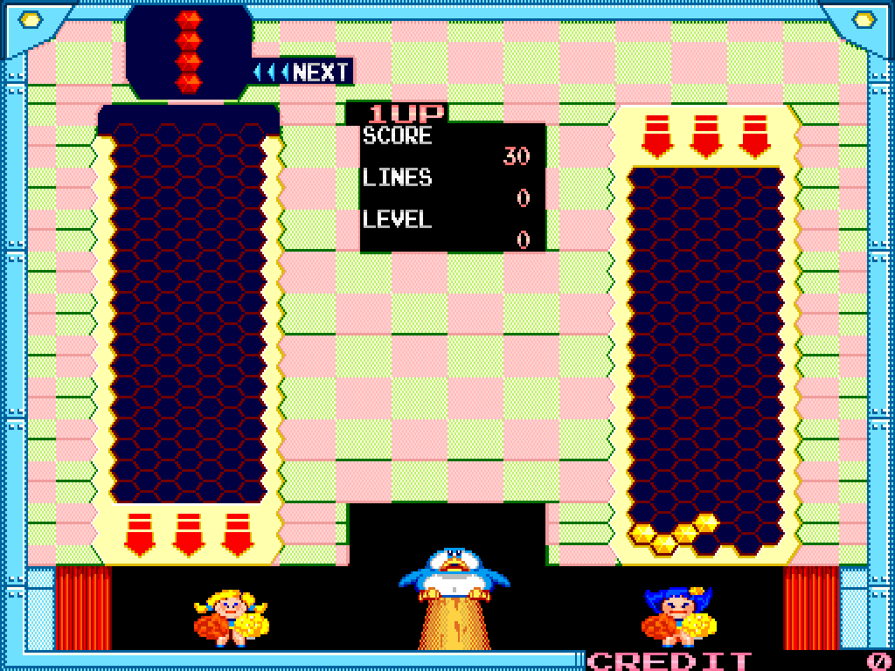

# Hexion for MiSTer

A MiSTer FPGA core for **Hexion** (Konami, 1992; GX122), the falling-hexagon puzzle game, and its Impeuropex bootleg: a Z80B, the
K053252 (CCU), two 8 x 8 tilemaps, the 052591 (PMC) used as a VRAM filler, and the K051649 (SCC) with an MSM6295 for sound (the bootleg:
a second MSM6295 instead of the SCC). Written from MAME 0.289's driver (`src/mame/konami/hexion.cpp`, with `k053252.cpp`,
`k051649.cpp`, `okim6295.cpp`), with MAME as the reference for everything; the platform layer follows the owner's Rabbit and Mystic
Warriors cores.

No ROMs or other copyrighted data are in this repository; you supply your own MAME `hexion.zip`.

  
  

The title screen and a game as the core draws them (the system bench, `sim/run_sys.sh`, frames 400 and 1,200 of its scripted play;
shown at the board's 4:3).

**Status.** Release 20261025, **tested on a real MiSTer by the owner with a RetroTINK 4K in direct video and a Sony PVM: the three
Video Timing settings work as intended** (288 lines (Native) on the PVM; 263 lines (RT4K 54Hz) on the RT4K as "MiSTer 240p" with a
4:3 picture; 263 lines (CRT+RT4K) on both). The first release, 20261023, ran on that MiSTer, but the RT4K took the board's 288-line
signal as "MiSTer Gen.", stretched it and dropped out every 13 s or so; test builds on the same hardware then chose the settings
(263 lines at 15.625 kHz is "MiSTer 240p" on the RT4K and locks on the PVM; 266 to 282 lines are "MiSTer Gen." again; 263 lines at
14.27 kHz is "MiSTer 240p" but the PVM does not lock). In simulation the core is compared with MAME 0.289 (see "What is verified":
the Z80 on MAME's cycle, the machine's RAM and VRAM byte for byte MAME's through 1,200 frames of scripted play); built with Quartus
17.0.2, timing met.

## Install

1. Unzip `Hexion_MiSTer_<date>.zip` (`tools/package.py` writes it to `dist/`) over the root of the SD card (`/media/fat/`): the core
   goes to `_Arcade/cores/`, `Hexion (Japan ver JAB).mra` to `_Arcade/` and the bootleg's MRA to `_Arcade/_alternatives/_Hexion/`. (By
   hand from the repository: `releases/hexion_<date>.rbf` to `_Arcade/cores/`, the contents of `mra/` to `_Arcade/`. Keep the RBF's
   `hexion_` name: MiSTer finds the core by the MRA's `<rbf>`. Delete an older `hexion_*.rbf` from `_Arcade/cores/`, so that there
   is no doubt which one the MRA starts.)
2. Put your MAME 0.289 `hexion.zip` (the merged set holds both versions) in `/media/fat/games/mame/`.
3. Start `Hexion (Japan ver JAB)` (or the bootleg) from the Arcade menu. A recent Main_MiSTer copies the image to the DDR3 in one go
   (the MRAs' `address=`, the fast load) and the core reads it from there; an older one streams it.

| Set | MRA |
|---|---|
| `hexion` | Hexion (Japan ver JAB) |
| `hexionb` | Hexion (Asia ver AAA, bootleg) |

## Controls and OSD

A joystick and two buttons per player, Start and Coin. The buttons are named by what they do (measured in MAME 0.289): **Rotate Left**
(MAME's button 1) turns the falling piece counter-clockwise, **Rotate Right** (button 2) clockwise. Keyboard: 1 / 2 start, 5 / 6 coin,
9 service, F2 the service mode (while held; the DIP switch is in the OSD).

| Option | Values |
|---|---|
| Aspect ratio | Original (4:3), Full Screen, [ARC1], [ARC2] |
| Scale | Normal, V-Integer, HV-Integer, Narrower HV-Integer, HV-Integer+ (the framework's integer scaling for HDMI) |
| Scandoubler Fx | None, HQ2x, CRT 25 / 50 / 75 % |
| Video Timing | **288 lines (Native)**, the default: the board's raster (below), for a CRT and for the framework's HDMI scaler. **263 lines (RT4K 54Hz)**: for a RetroTINK 4K in direct video (DV1), which takes the board's 288 lines as "MiSTer Gen." (stretched, and dropping out now and then) and 263 as "MiSTer 240p": the board's frame time on 263 lines, in step with the game (54.25 Hz, no torn or repeated frames), the picture widened to fill 84 % of the line as the RT4K judges width by time; 14.27 kHz, so not for a CRT. **263 lines (CRT+RT4K)**: one setting for both a 15 kHz CRT and the RT4K: the board's 15.625 kHz line on 263 lines, 59.41 Hz, while the game keeps its 54.25 Hz underneath, so about 5 pictures a second repeat a game frame and a change of the picture can tear; the picture is the board's width (narrow-ish). CRT Adjust works with 288 lines only |
| CRT Adjust (page) | Off, On; H-Size 0 to +3 and -16 to -1, H-Position -48 to +16, V-Shift -16 to +15: rmonic79's CRT Adjust (`modules/crt-adjust`, with a line buffer sized for this core's 768-dot line) for a 15 kHz analog output, the picture moved and sized through a line buffer while the sync keeps its timing, so the monitor stays locked. A size step is 1/32 of a dot (16 dots across the picture); the module scales the picture's distance from the hsync pulse too, and +3 is the most that ends before the next one. It does nothing while the scandoubler is on (31 kHz) or with the 263-line Video Timings (greyed out) |
| DIP switches | MAME's: Coin A, Coin B (Konami's table; 0 is Free Play), Difficulty (1 Easiest .. 8 Hardest, 4 Medium), Demo Sounds, Flip Screen, Service Mode |
| Volume | Normal, -6 dB, -12 dB, +6 dB |

The video is the board's: 512 x 256 in a 768 x 288 raster at a 12 MHz dot, 15.625 kHz and 54.25 Hz (MAME's own timing for this game,
from the K053252's registers as the game programs them). The 263-line Video Timings draw the same 512 x 256 picture on a raster of
their own; the game runs on the board's raster in every setting, so its speed, sound and state never change (`docs/hardware.md`,
"The 263-line Video Timings"). Users of the MiSTer's own HDMI scaler (no direct video) want 288 lines (Native): the scaler takes
any line count, and with `vsync_adjust` it runs the HDMI output at the game's 54.25 Hz.

## What is verified

| | |
|---|---|
| ROM image | `tools/make_mra.py hexion.zip` assembles both MRAs' images (`tools/mra_build.py`, the MiSTer MRA rules) and compares them with the image `tools/hexion_rom.py` builds by MAME's loading rules: identical |
| The picture's rules | `tools/hexion_ref.py`, MAME's tilemap, gfx layout and palette rules in Python, renders MAME's own VRAM (dumped with `tools/lua/dump.lua`) pixel-identical to MAME's snapshots (the RAM test, the mode select, a game), with Flip Screen too. MAME's palette is not a plain 4-to-8-bit expansion: `palette_init_rgb_444_proms` weighs the PROM bits 0x0e, 0x1f, 0x43, 0x8f, which the core does too |
| The Z80 against MAME, cycle by cycle | MAME's debugger trace with each instruction's cycle count against the bench's (`sim/tb_top.sv` +ITRACE, `tools/cmp_trace.py`): the power-on frame (15,453 instructions), frames 60-70 (204,000) and 100-101 (18,572, the IRQ and NMI handlers with them): every instruction starts on MAME's cycle (rechecked with the interrupt hold of Video Timing 263 in the core: unchanged). Getting there took three changes: tv80's NMI is now 11 T-states, as a Z80's (it had 15); its power-on registers are MAME's; and the scanline events reach it 25 clocks early, since tv80 decides on an interrupt one step before an instruction's end and MAME takes one raised at any time in the instruction (`modules/VENDOR.md`, `rtl/hexion_core.sv`). And tv80 is built with its R register (`TV80_REFRESH`): the game takes its random numbers from `LD A,R` (c99f, c9a8), and without R the bootleg's play left MAME's at frame 1,139 |
| Whole machine | `sim/run_sys.sh`: the Z80 running the game's program, the ROM image downloaded through the loader into the SDRAM controller and a behavioural SDRAM (which checks its timing: no violation), the video, both sound chips. Against MAME 0.289 under the same scripted inputs, the work RAM and both VRAM banks at the start of the vertical blank (`tools/cmp_ram.py`): **byte for byte MAME's at all 121 dumps of scripted play** (every 10th frame to 1,200: the RAM / ROM test, a coin, start, the mode select, a game with moves and both buttons), at all 121 of the bootleg's (its second OKI in place of the SCC) and at all 51 of the test mode (`SCHED=test`: the MASK ROM CHECK, which reads all 512 KB of tile ROM through the f500 window, so the Z80 waits for the SDRAM and gets the cycles back); with Flip Screen the pictures of frames 100 and 600 are MAME's. The pictures (`tools/cmp_frames.py`): MAME's snapshots pixel for pixel at every 100th frame of the RAM test, the attract mode and the mode select and in all of the test mode; in the game the animated arrows above the playfield differ (16 to 514 pixels), because the game rewrites them while the beam is below them (a Lua write tap: VRAM writes at lines 0-96 of a frame), which the core shows from the next frame on and MAME at once ("Where the core is not MAME"). **The 263-line Video Timings** (`+VMODE=1` / `2`): with 263 lines (RT4K 54Hz) the same 121 of 121 dumps of play, all 121 of the bootleg's and 51 of 51 of the test mode, and with 263 lines (CRT+RT4K) 51 of 51 of the test mode too. In the RT4K 54Hz test mode the core holds 122 interrupts back by 1 to 48 Z80 cycles, because the Z80 was still catching up after a tile ROM window read (`rtl/hexion_core.sv`; before that hold, 5 of the 51 dumps had other stack bytes than MAME's). With the board's raster no interrupt needs the hold in any run. The RT4K 54Hz pictures are MAME's in 85 of 121 (the board's raster: 90). The others differ only in the arrows' rows (24-62), plus a power-on frame (row 0) and a menu frame (rows 16-20) |
| Sound | The bench's output (`AUDIO=1`) against MAME's `-wavwrite` recording of the same scripted play (`tools/audio_cmp.py`): the loudness envelopes (RMS per frame) correlate **0.998** (the bootleg 0.999) at no lag over frames 30-1,200, the level within 3 % |
| MiSTer top level | `sim/emu/run_emu.sh`: `Hexion.sv` with the framework's video path (`arcade_video`, the scaler's input), `hps_io` and the PLL stubbed, the SDRAM and the DDR3 modelled (the DDR3 busy a random 10 % of the clocks). Both the fast load (`FAST=1`: the image in the DDR3 at byte 0x32000000, a download that carries only its length) and the streamed load leave the SDRAM byte-identical to the expected layout for both sets, with the board byte and the DIP switches arrived (the fast load in 0.05 s of machine time). Every frame is 1,769,472 clocks (54.25 Hz) with 256 rows of 512 pixels in 288 lines, each row 179 dots after the hsync pulse starts; Scandoubler Fx HQ2x and MiSTer.ini's `forced_scandoubler` give 512 rows in 576 lines, every frame whole; CRT Adjust On at its zero settings is the plain picture pixel for pixel (frame 100: MAME's snapshot), at H-Size +3 every row has its 512 pixels in 4,480 clocks and at -16 in 2,048, every frame whole. 263 lines (RT4K 54Hz) (`VMODE=1`, both loads): every frame still 1,769,472 clocks, 256 rows in 263 lines, hsync to hsync 6,728 clocks but for one line of 6,736, each row 997 clocks after the hsync pulse starts and 5,632 clocks (58.7 us) wide; 263 lines (CRT+RT4K) (`VMODE=2`): every frame 1,615,872 clocks (59.41 Hz), hsync to hsync 6,144, rows as the board's; in both the pictures pixel for pixel the board raster's, and the framework's direct-video DE (`sys_top.v`'s logic, modelled in the bench from HS / VS on the pixel enable) is exactly the picture's 256 lines, no picture dot outside it (the board's raster: 271 lines); HQ2x 512 rows in 526 lines |
| Quartus 17.0.2 | Release 20261025: 27 % of the ALMs (11,352), 260 of 553 M10K, 36 DSPs; every clock's slack positive (the 96 MHz machine clock +1.251 ns setup, +0.247 ns hold; the framework's HDMI scaler +0.799 ns setup, +0.258 ns hold; fitter seed 2): `releases/hexion_20261025.fit.summary` / `.sta.summary` |
| Lint | Verilator `-Wall` (`sim/lint.sh`) |

## Where the core is not MAME

* **The tilemaps are read as the beam runs** (each line is fetched during the line before it), as a board's tilemap hardware reads its
  VRAM; MAME draws the whole frame at the start of the vertical blank. Hexion writes VRAM during the visible lines too (in a game, the
  animated arrows above the playfields at lines 60-100), so such a change shows from the next frame here and in the same frame in
  MAME. The machine's state is MAME's either way.
* **The 263-line Video Timings are not the board's raster.** They exist for a RetroTINK 4K in direct video (above); the game runs on
  the board's raster in both. 263 lines (RT4K 54Hz) has the board's frame time, but its lines are 9.5 % longer than the board's and
  its vertical blank 7 lines instead of 32, so the beam passes each row at a different moment and the rows the game rewrites while
  the beam runs (the arrows) show a frame apart from MAME somewhat more often (its phase to the game's raster is chosen from where the
  game writes VRAM: `docs/hardware.md`). 263 lines (CRT+RT4K) runs at 59.41 Hz free of the game's 54.25 Hz: some game frames show in
  two pictures, and a change of the picture can tear.
* **MAME's memory is instant.** The core's Z80 waits for two things MAME does in no time: a read of the tile ROM window (an SDRAM read,
  the test mode's MASK ROM CHECK) and the PMC's fill of a VRAM bank (2,048 clocks of 96 MHz). The cycles it misses are given back right
  after (a step every 8 clocks instead of 16), so the program stays on MAME's timeline (the test mode's state is MAME's byte for byte).
* **The sound's resampling.** The SCC runs at its 3 MHz and the core averages it over 64 samples (46.875 kHz output); MAME resamples
  its streams with its own filter. The levels are MAME's mix (OKI and SCC at 0.5 each).

## Repository layout

| Path | |
|---|---|
| `Hexion.sv`, `Hexion.q*`, `Hexion.sdc`, `files.qip` | the MiSTer top level (`emu`), Quartus project, timing constraints |
| `rtl/` | the machine: `hexion_core` (the board: the Z80's bus, the banked RAM, the PMC's fills, the CCU's registers and interrupts, the sound mix), `hexion_video` (the raster, the tilemaps, the PROMs), `hexion_scc` (K051649), `hexion_oki` (MSM6295), `hexion_ram`; the platform: `hexion_sdram`, `hexion_loader`, `hexion_fastload`, `hexion_standby` |
| `modules/` | vendored: tv80 (with local changes: the NMI's T-states, MAME's power-on register values), rmonic79's CRT Adjust (`modules/VENDOR.md`) |
| `sys/` | the MiSTer framework |
| `mra/` | the MRAs (`tools/make_mra.py`) |
| `sim/` | Verilator benches: the whole machine (`run_sys.sh`, with the instruction trace +ITRACE, the VRAM write log +VWLOG, the Video Timing +VMODE), the MiSTer top level (`emu/run_emu.sh`), lint |
| `tools/` | ROM image builder (`hexion_rom.py`), MRA writer, the MAME Lua dump (`lua/dump.lua`) and its runner (`mame_dump.sh`), the reference renderer (`hexion_ref.py`), comparisons (`cmp_ram.py`, `cmp_frame.py`, `cmp_frames.py`, `cmp_trace.py`, `audio_cmp.py`), release zip (`package.py`) |
| `docs/` | `hardware.md`: the hardware as MAME describes it and the measurements |
| `releases/` | the RBF of each release with its fitter and timing summaries |

## Building

Quartus Prime Lite 17.0.2:

    quartus_sh --flow compile Hexion

Copy `output_files/Hexion.rbf` to `releases/hexion_<YYYYMMDD>.rbf`; `python3 tools/package.py` then writes the SD card zip
(`dist/Hexion_MiSTer_<YYYYMMDD>.zip`).

The benches need Verilator 5 (in WSL), Python 3 and your romset:

    python3 tools/hexion_rom.py hexion.zip hexion hexion.rom
    SCHED=play SNAPEVERY=100 AUDIO=1 sim/run_sys.sh hexion.rom 1201 out/a +DUMPDIR=out +DUMPFROM=0 +DUMPTO=1200 +DUMPEVERY=10
    DUMPFROM=0 DUMPTO=1200 DUMPEVERY=10 SCHED=play WAV=ref/mame.wav tools/mame_dump.sh ref      # MAME's (Git Bash)
    python3 tools/cmp_ram.py ref out; python3 tools/cmp_frames.py ref out/a; python3 tools/audio_cmp.py out/a.wav ref/mame.wav
    SCHED=test sim/run_sys.sh hexion.rom 1001 test/a +DSW=FF4FFB +DUMPDIR=test +DUMPFROM=0 +DUMPTO=1000 +DUMPEVERY=20   # the test mode
    sim/emu/run_emu.sh /full/path/hexion.rom 110 emu/a                                    # the MiSTer top level (FAST=1: the fast load)

The instruction trace: MAME's debugger with `trace <file>,maincpu,noloop,{tracelog "%d ",totalcycles}` (started from Lua,
`manager.machine.debugger:command(...)`, with `-debug -debugger none`) against `sim/run_sys.sh ... +ITRACEFROM=<cycle> +ITRACE=<cycle>`,
compared by `tools/cmp_trace.py`.

MAME's captures, the images and the benches' pictures go to a scratch folder `work/` next to the repository (never committed):
`tools/mame_dump.sh` takes the romset from `work/roms` and runs MAME in `work/mame_run` unless `ROMPATH` / `WORK` say otherwise.

## Credits

* **MAME**: the hexion driver (Nicola Salmoria), the K053252 (Angelo Salese, from Olivier Galibert's notes), the K051649 (Bryan
  McPhail), the MSM6295 and its ADPCM; the hardware knowledge and the reference for every comparison. furrtek's SiliconRE notes on
  the 052591, quoted in the driver.
* **Guy Hutchison**: tv80 (MIT), with its clock-enable wrapper from plasticbugs/punchout.
* **rmonic79 (Umberto Parisi)**, with Andrea Bogazzi (asturur): CRT Adjust (GPL-3.0-or-later).
* The owner's Rabbit core: the SDRAM controller and its simulation model (via decoryah/Arcade-Metro_MiSTer, from searchsolved's
  Arcade-HyperDuel_MiSTer), the fast load (from the Metro core) and the DDR3 model, the standby raster, the CRT Adjust glue, the MRA tools; the Mystic Warriors core: the tv80 integration
  and its timing constraints.
* The MiSTer framework (Sorgelig and contributors).

## Licence

GPL-3.0-or-later (`LICENSE`); vendored modules keep their own licences.
